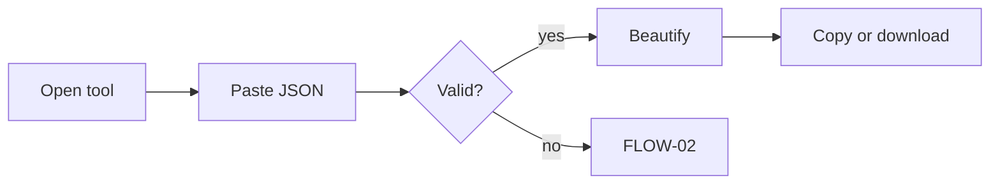

## Goal
Turn a pasted blob of JSON into readable text and take it away.

## Diagram

## Steps
1. Open the tool — SCR-Formatter, empty state.
2. Paste — F-001.R1; validated automatically — F-005.R1.
3. Choose indent and beautify — F-002.R1, F-002.R2.
4. Copy or download — F-007.R1, F-007.R2.

## Exits & failures
- Invalid input → FLOW-02. Leaving the page discards the document (PRN-01).
