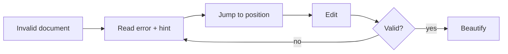

## Goal
Locate why JSON is invalid and fix it by hand.

## Diagram

## Steps
1. Status shows invalid; issue panel shows code, location, hint — F-005.R2, F-005.R3.
2. Jump to the error — F-005.R5.
3. Edit the text; validation re-runs — F-005.R1.
4. Once valid, beautify — F-002.R1.

## Exits & failures
- Beautify while still invalid leaves the text unchanged and refocuses the error — F-002.R4.
