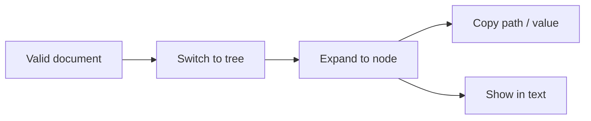

## Goal
In a large payload, locate a nested value and copy its path or value for use elsewhere.

## Diagram

## Steps
1. Load the document — F-001.
2. Switch to tree view — F-006.R1.
3. Expand containers to the node — F-006.R3.
4. Copy path or value — F-006.R4, F-006.R5; or reveal in text — F-006.R6.

## Exits & failures
- Document invalid → tree explains and offers jump to error — F-006.R7, then FLOW-02.
