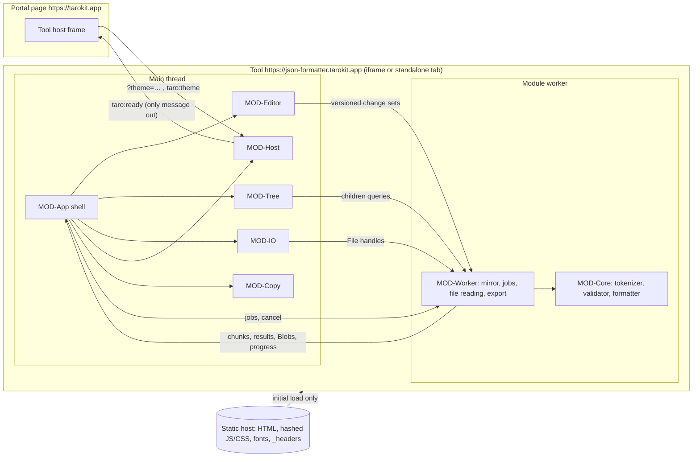

# Architecture

Status: proposed (2026-10-13). Decisions: ADR-0001 … ADR-0012. Modules: `modules/`.
Dependencies: `dependencies.md`. Platform details: `platform-mapping.md`.
Spike plan: `.build-my-app/reports/spike-plan.md`.

## Summary
A static single-page web app at `https://json-formatter.tarokit.app`, embedded by the taro-kit
portal (`https://tarokit.app`) in a sandboxed iframe and fully usable standalone. **Preact 10 +
signals** render a small shell (ADR-0002); **CodeMirror 6** is the text editor at every size
tier (ADR-0004); a **hand-written iterative streaming tokenizer** (MOD-Core) runs in **one
module worker** that keeps a mirror of the document and does all validation, formatting,
re-indenting, file decoding, tree scanning and export (ADR-0005). Large results enter the
editor through a **chunked commit** with a single undo step and a tier-aware **custom undo
history** (ADR-0006). The tree is built **lazily from token offsets** with a small skip table
and drawn by a custom virtual list (ADR-0007). Built with **TypeScript 6 + Vite 8 + pnpm**
(ADR-0003), styled with **plain CSS and the portal's tokens** (ADR-0011), hosted on
**Cloudflare static assets** with a header-delivered strict CSP (`connect-src 'none'`,
`frame-ancestors https://tarokit.app`) (ADR-0009), tested with **Vitest, fast-check,
JSONTestSuite, Playwright ×3 engines, axe, Lighthouse CI** (ADR-0010). Stack choices mirror the
portal's wherever they fit.

## Assumptions
- A1. Reference machine as defined at the top of `50-quality/nfr.md` (4+ cores, 16 GB RAM, current desktop
  browser); the 1.5 GB peak (NFR-04) is the tool's renderer + worker memory.
- A2. Documents are mostly ASCII. Non-ASCII text is held as two-byte strings by JS engines,
  roughly doubling the text part of the memory table below (covered by a spike fixture).
- A3. The portal frames the tool with `sandbox="allow-scripts allow-same-origin allow-forms
  allow-downloads"`, `allow="clipboard-write"`, `referrerpolicy="strict-origin"`, and will pass
  the theme per its change request (`taro:theme` / `taro:ready`, D-008).
- A4. No backend, no accounts, no storage of any kind in M-1 (PRN-01). The optional offline
  service worker (ADR-0012) stores only the tool's own code.
- A5. Desktop only (NFR-07); touch is not optimised but nothing prevents it.
- A6. English only in M-1.

## System context

After load, no arrow leaves the tool except `taro:ready` (INV-02, NFR-01; enforced by CSP
`connect-src 'none'`, the lint ban on network APIs, and the e2e request recorder).

## Modules
| Module | Thread | Responsibility (short) | Main features / NFRs |
|---|---|---|---|
| MOD-Core | worker (pure helpers also main) | Iterative tokenizer, validation, beautify/minify, re-indent, paths, facts, tree scans | F-002, F-003, F-004, F-005, F-006 data; INV-01; NFR-03, NFR-08 |
| MOD-Worker | worker | Mirror, job scheduling, cancellation, file decode, export Blobs | F-001.R5/R8/R9, F-005.R7; INV-03, INV-05; NFR-02, NFR-04 |
| MOD-Editor | main | Editor engine, tiers, chunked commit, undo history, markers | F-001.R1/R6/R7, F-005.R5; INV-04; RULE-15 |
| MOD-Tree | main (lazy chunk) | Row model, RULE-12 groups, virtual list, copy/reveal | F-006 |
| MOD-Host | main + inline boot | Theme, origin-checked messages, ready signal | F-008; RULE-16; NFR-09 |
| MOD-IO | main | File pick/drop, clipboard, download with fallbacks | F-001.R2/R3, F-007 |
| MOD-App | main | Shell components, app state, operation orchestration | SCR-Formatter, F-009; NFR-02, NFR-06 |
| MOD-Copy | main | Generated strings, hints, size formatting | copy.md |
| MOD-Build | build/CI | Codegen, `_headers`, size and license gates, deploy | NFR-01, NFR-05, NFR-09 |

Dependency rule: MOD-Core imports nothing; MOD-Worker imports only MOD-Core and
`@codemirror/state`; nothing in the worker imports DOM code (lint-enforced import boundaries).

## Threading model
- **Main thread**: input, rendering, editor view, tree rendering, orchestration. Every task
  is ≤ ~8 ms when building documents (sliced and yielded), so frames stay < 50 ms (NFR-04).
- **One module worker**: all O(n) work. One job at a time; each job runs in slices of
  ~30 ms / ~4 MB, yielding so `cancel` and `edit` messages arrive within one slice (NFR-02
  cancel). No `SharedArrayBuffer` (cross-origin isolation is not available in the frame).
- **Versions**: every editor change increments the document version; every worker message
  carries it; stale results are dropped; the UI shows COPY-status.checking / COPY-tree.checking
  while the current version is unvalidated (INV-05).
- **Busy policy** (D-005): during a tool operation the editor is read-only, toolbar actions
  other than cancel are disabled, scrolling stays available; progress appears after 0.5 s,
  cancel is offered from the start (NFR-02).

## Data flows

### Load (open or drop a file)
```mermaid
sequenceDiagram
  participant U as User
  participant A as MOD-App
  participant IO as MOD-IO
  participant W as MOD-Worker
  participant E as MOD-Editor
  U->>IO: choose / drop file
  IO->>A: File (size known)
  A->>A: tier from File.size (RULE-02); >100 MB → confirm (F-001.AC5)
  A->>W: loadFile(file, job)
  A->>E: beginReplace("load") → pending
  loop chunks (stream, fatal UTF-8, BOM kept)
    W->>W: decode + validate incrementally + build pending mirror
    W->>A: chunk(text), progress
    A->>E: pending.append(chunk) (≤8 ms slices)
  end
  alt success
    W->>A: done + validation result
    A->>E: pending.commit() (one undo step, new version)
    A->>W: adopt(version, job)
  else invalid UTF-8 / too large / cancel
    W->>A: failed(reason)
    A->>E: pending.discard() (document untouched, INV-03)
  end
```

### Edit → validate
Editor transaction → change set + version → worker applies to mirror → validation scheduled
(immediately below 1 MB; after ~150–300 ms of idle in larger tiers; superseded by newer
edits) → result → status bar, issue panel, error marker. Size/lines in the status bar update
synchronously from the editor (line count) and incrementally tracked UTF-8 length (F-005.AC7).

### Beautify / minify / re-indent
```mermaid
sequenceDiagram
  participant A as MOD-App
  participant W as MOD-Worker
  participant E as MOD-Editor
  A->>E: setBusy(true)
  A->>W: format(version, mode)
  alt mirror version known invalid
    W->>A: failed(invalid, first error)
    A->>E: setBusy(false); markIssue + focus (F-002.R4, F-003.R3)
  else valid
    loop output chunks (exact token slices + whitespace)
      W->>A: chunk, progress
      A->>E: pending.append
    end
    W->>A: formatted
    A->>E: pending.commit() (one undo step, tool-op marker)
    A->>W: adopt(version) → re-validate new text for positions of warnings
  end
  Note over A,W: cancel → worker stops within one slice; pending.discard()
```
Re-indent follows the same path; the worker first detects the unit and may answer
"not indented" (COPY-notice.no_indent, F-004.R5) without touching the document.

### Tree
Switch to tree → (if valid) worker builds the skip table for the current version (progress
COPY-progress.tree, cancellable) → root rows → MOD-Tree renders; expanding a group asks the
worker for ≤ 100 rows; copy value asks for a Blob of the node span; reveal selects the span
in the editor. Document change → tree marked stale, refreshed after re-validation.

### Copy / download
The worker builds a UTF-8 `Blob` from the mirror (joined with the document's line ending).
Copy writes it as a clipboard item created synchronously inside the click handler with a
promised Blob (keeps the user gesture across engines); download uses an object URL and a
`download` link named per RULE-10. Blocked outcomes trigger the spec fallbacks (select all +
COPY-error.clipboard; COPY-error.download).

## Memory strategy for 100 MB (NFR-04: peak < 1.5 GB)
Estimates for a formatted 100 MB ASCII document (~3.3 M lines). Editor `Text` stores each line
as a JS string: ~100 MB of characters + ~20–25 bytes per line overhead ≈ **~175 MB per copy**.

| Item | Live when | Estimate |
|---|---|---|
| Current document (main) | always | ~175 MB |
| Worker mirror | always | ~175 MB |
| Undo: up to 3 previous documents (large tier, whole-document tool ops) | after 3+ tool ops | ≤ ~525 MB (0 with the Blob fallback of ADR-0006) |
| Pending document during load/format (main) | during an operation | ~175 MB (becomes current on commit) |
| Worker: old mirror until adopt | during an operation | ~175 MB (released on adopt) |
| Output chunks in flight | during an operation | ≤ ~16 MB (bounded queue) |
| Skip table + tree caches | tree used | ≤ ~10 MB |
| Editor view, UI, code | always | ~50–100 MB |
| **Worst-case peak (4th tool op on 100 MB)** | | **≈ 1.2–1.35 GB** |

Rules: no full-document strings are ever built on the main thread (no `toString()` of the
document; exports are Blobs from the worker); chunks are bounded (~1–4 MB) and released after
append; at most one pending document; the worker releases a superseded mirror on `adopt`;
syntax-tree parsing is off above 10 MB. The peak is close to the limit, so SP-pipeline
measures it; the Blob-backed undo fallback (ADR-0006) cuts ~525 MB if needed. A minified
100 MB document (one line) costs ~100 MB per copy, well inside the budget. Non-ASCII content
roughly doubles text bytes (assumption A2) — measured in the spike; the very-large tier is
best effort anyway (RULE-02).

## Budgets and baselines

### Startup (NFR-05: interactive ≤ 1.5 s cold at 10 Mbit/s & 40 ms RTT; ≤ 0.5 s cached)
Cold arithmetic: connection setup (DNS + TCP + TLS 1.3) ≈ 3 RTT = 120 ms; HTML ≈ 1 RTT +
transfer; critical JS/CSS fetched in parallel via module preload ≈ 1 RTT + transfer at
1.25 MB/s (slow start adds ~2–3 RTT for 250 KB); parse/compile/execute of ~700 KB raw JS
≈ 150–250 ms on the reference machine; editor creation ≈ 30–50 ms. With a 250 KB critical path
this lands at ≈ 0.8–0.9 s, leaving ~0.6 s headroom.

| Item (compressed, brotli/gzip) | Budget | Estimate |
|---|---|---|
| HTML (incl. inline boot script, inline SVG icons) | ≤ 15 KB | ~8 KB |
| CSS (tokens + base + components + editor theme) | ≤ 20 KB | ~12 KB |
| JS critical path: Preact + signals | ≤ 10 KB | ~8 KB |
| JS critical path: CodeMirror (state, view, commands, language, lang-json, Lezer) | ≤ 160 KB | ~130–150 KB |
| JS critical path: app shell, editor integration, host, IO, copy | ≤ 45 KB | ~30 KB |
| **Critical path total (HTML + CSS + JS)** | **≤ 250 KB** | ~190–215 KB |
| Worker chunk (MOD-Core + MOD-Worker + `@codemirror/state`), loaded in parallel | ≤ 60 KB | ~40 KB |
| Tree chunk (lazy) | ≤ 30 KB | ~15 KB |
| Fonts (2 variable WOFF2 Latin subsets, swap, not blocking) | ≤ 80 KB | ~60–80 KB |
| **Total initial transfer** | **≤ 420 KB** | |

Enforced by the build size gate (PR) and Lighthouse CI with matched throttling (ADR-0010).
Cached: hashed assets are immutable; only the HTML revalidates (one 304 round trip).

### Runtime targets (spike pass criteria derive from these)
| Measure | Target | Source |
|---|---|---|
| Core validate/format throughput in the worker | ≥ 50 MB/s (NFR-03 needs ≥ 10 MB/s end to end) | NFR-03, SP-formatter |
| 10 MB beautify, click → document shown | ≤ 1 s | NFR-03 |
| 100 MB beautify, click → document shown | ≤ 10 s | NFR-03 |
| Longest main-thread task during load/format/commit/scroll | ≤ 50 ms | NFR-04 |
| Keystroke → paint at 100 MB | ≤ 100 ms (aim 50 ms) | NFR-02 |
| Cancel → UI idle and document unchanged | ≤ 200 ms | NFR-02, INV-03 |
| Progress shown | after 0.5 s | NFR-02 |
| Tree: first group of a 100,000-child container | ≤ 100 ms | F-006.AC9 |
| Tree: expand root of 50 MB | ≤ 500 ms | SP-tree |
| Peak memory, 100 MB worst case | < 1.5 GB | NFR-04 |

### Tunable constants (initial values, set by spikes)
Large-paste interception 1 MB; worker slice 30 ms / 4 MB; main append slice 8 ms; chunk size
1–4 MB; validation debounce 0 / 150 / 300 ms by tier; skip-table threshold 4 KB; tree row
preview 200 characters; normal-tier editor extras off above 10 MB (RULE-02).

## Risks (ranked) and how they are retired
1. **100 MB in the editor** (open, scroll, type, undo memory) — SP-editor, SP-pipeline.
2. **Peak memory with mirror + 3 undo snapshots** — SP-pipeline; fallback Blob-backed undo.
3. **Tokenizer throughput and exactness** (positions, unsafe numbers, chunk boundaries,
   conformance) — SP-formatter; property and conformance tests.
4. **Tree scan latency on huge containers** — SP-tree; skip-table threshold tuning.
5. **Iframe platform behaviour** (clipboard of large content, download, drop, CSP with editor
   styles, theme without flash) across three engines — SP-iframe.
6. **Beautified size explosion**: deeply nested input (e.g. 10,000 levels) beautified with
   wide indents grows quadratically (≈ 200 MB from a 20 KB input at 2 spaces). Validation
   predicts the output size per indent; see open issue O-2.

## Open issues for the user (spec clarifications)
- **O-1 Mixed line endings**: the editor model unifies line breaks; documents with mixed
  LF/CRLF are written out with the dominant ending (ADR-0006). Proposed spec note on
  ENT-Document / F-001 edge cases: "mixed line endings are normalised to the dominant one".
- **O-2 Oversized results**: RULE-02 confirmation covers loading and pasting only. Proposed:
  if a beautify result would exceed 100 MB, ask for the same confirmation first.
- **O-3 Blocked downloads**: browsers give no reliable signal when a sandbox blocks a
  download, so F-007.AC6 can only be met where detectable (the portal grants downloads, so
  embedded use is unaffected). Proposed spec note similar to the portal's "where the browser
  can restrict them".
- **O-4 Find in text**: browser find does not see virtualized text. Not in the M-1 spec; the
  editor's search panel could be added (small) if wanted.
- **O-5 Offline**: the portal lists the tool as offline-capable; M-1 specs do not require it.
  ADR-0012 shows an NFR-01-compatible way; needs a spec item if wanted.
