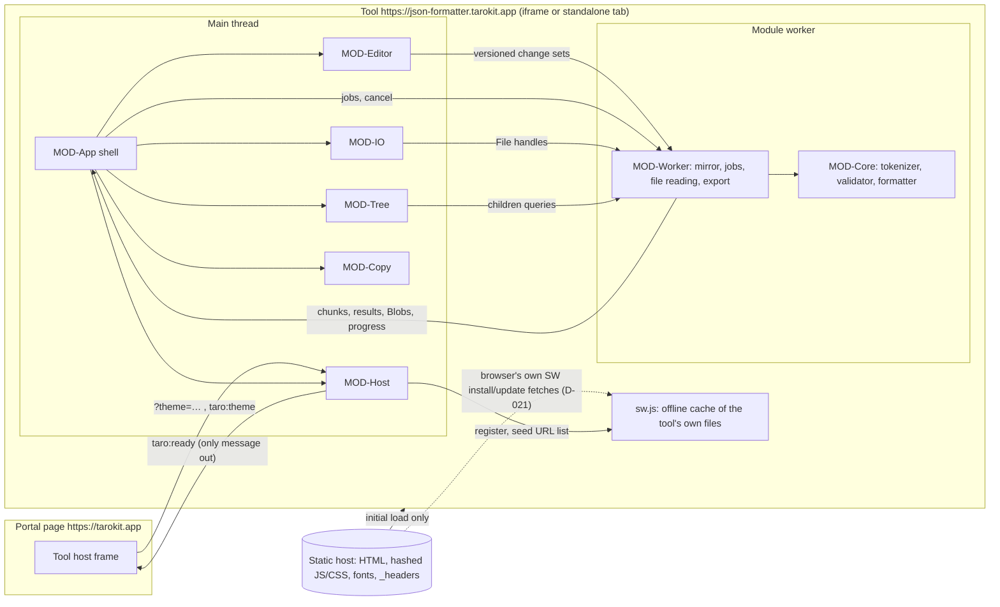

# Architecture

Status: proposed (2026-10-13). Decisions: ADR-0001 … ADR-0012. Modules: `modules/`.
Dependencies: `dependencies.md`. Platform details: `platform-mapping.md`.
Spike plan: `.build-my-app/reports/spike-plan.md`. Spike results applied: SP-formatter,
SP-editor, SP-iframe, SP-pipeline, SP-tree (`.build-my-app/reports/spike-*.md`).

## Summary
A static single-page web app at `https://json-formatter.tarokit.app`, embedded by the taro-kit
portal (`https://tarokit.app`) in a sandboxed iframe and fully usable standalone. **Preact 10 +
signals** render a small shell (ADR-0002); **CodeMirror 6**, mounted in a shadow root so its
styles stay CSP-clean, is the text editor at every size tier, with our own find engine and
undo history (ADR-0004); a **hand-written iterative streaming tokenizer** (MOD-Core) runs in **one
module worker** that keeps a compact mirror of the document and does all validation, formatting,
re-indenting, file decoding, tree scanning and export (ADR-0005). Large results enter the
editor through a **chunked commit** with a single undo step and a tier-aware **custom undo
history** whose large-tier tool-operation snapshots are Blobs (ADR-0006). The tree is built
**lazily from token offsets** with a skip table and per-container checkpoints, modelled as a
range tree and drawn by a custom virtual list (ADR-0007). Built with **TypeScript 6 + Vite 8 + pnpm**
(ADR-0003), styled with **plain CSS and the portal's tokens** (ADR-0011), hosted on
**Cloudflare static assets** with a header-delivered strict CSP (`connect-src 'none'`,
`frame-ancestors https://tarokit.app`) (ADR-0009), offline after one visit through a
hand-written service worker seeded from the HTTP cache (ADR-0012), tested with **Vitest, fast-check,
JSONTestSuite, Playwright ×3 engines, axe, Lighthouse CI** (ADR-0010). Stack choices mirror the
portal's wherever they fit.

## Assumptions
- A1. Reference machine as defined at the top of `50-quality/nfr.md` (4+ cores, 16 GB RAM, current desktop
  browser); NFR-04 memory is the tool's renderer + worker memory (peak footprint as the OS
  reports it). How NFR-04 is measured across engines is being decided; see "Known limits".
- A2. Documents are mostly ASCII. Non-ASCII text is held as two-byte strings by JS engines,
  roughly doubling the text part of the memory table below (covered by a spike fixture).
- A3. The portal frames the tool with `sandbox="allow-scripts allow-same-origin allow-forms
  allow-downloads"`, `allow="clipboard-write"`, `referrerpolicy="strict-origin"`, and will pass
  the theme per its change request (`taro:theme` / `taro:ready`, D-008). Without
  `allow-popups` the frame blocks new tabs, so the notices link and the source link (F-009.R3)
  open only standalone. Change request to the portal: add `allow-popups
  allow-popups-to-escape-sandbox` (the second token so the opened page is not sandboxed).
- A4. No backend, no accounts, no storage of any kind in M-1 (PRN-01). The offline service
  worker (ADR-0012, F-011) stores only the tool's own code in Cache Storage.
- A5. Desktop only (NFR-07); touch is not optimised but nothing prevents it.
- A6. English only in M-1.

## System context

After load, no arrow leaves the tool except `taro:ready` (INV-02, NFR-01; enforced by CSP
`connect-src 'none'`, the lint ban on network APIs, and the server-side request log in e2e).
The only allowed traffic after load is the browser fetching or update-checking the tool's
own files for the offline cache (NFR-01 as amended by D-021; only WebKit does this).

## Modules
| Module | Thread | Responsibility (short) | Main features / NFRs |
|---|---|---|---|
| MOD-Core | worker (pure helpers also main) | Iterative tokenizer, validation, beautify/minify, re-indent, paths, facts, tree scans | F-002, F-003, F-004, F-005, F-006 data; INV-01; NFR-03, NFR-08 |
| MOD-Worker | worker | Compact mirror, job scheduling, cancellation, file decode, export Blobs | F-001.R5/R8/R9, F-005.R7; INV-03, INV-05; NFR-02, NFR-04 |
| MOD-Editor | main | Editor engine (shadow root), tiers, chunked commit, undo history, markers, find engine | F-001.R1/R6/R7, F-005.R5, F-010; INV-04; RULE-15, RULE-18 |
| MOD-Tree | main (lazy chunk) | Range-tree row model, RULE-12 groups, virtual list, copy/reveal | F-006 |
| MOD-Host | main + inline boot + `sw.js` | Theme, language, origin-checked messages, ready signal, offline service worker | F-008, F-011, F-012; RULE-16, RULE-19; NFR-01, NFR-09 |
| MOD-IO | main | File pick/drop, clipboard (with fallback), download | F-001.R2/R3, F-007 |
| MOD-App | main | Shell components, app state, operation orchestration | SCR-Formatter, F-009; NFR-02, NFR-06 |
| MOD-Copy | main | Generated strings per language, active language, hints, number and size formatting | copy.md; F-012 |
| MOD-Build | build/CI | Codegen, `_headers`, size and license gates, deploy | NFR-01, NFR-05, NFR-09 |

Dependency rule: MOD-Core imports nothing; MOD-Worker imports only MOD-Core and
`@codemirror/state` (for `ChangeSet` decoding only; the mirror is not a CodeMirror `Text`); nothing in the worker imports DOM code (lint-enforced import boundaries).

## Threading model
- **Main thread**: input, rendering, editor view, tree rendering, orchestration. Every task
  is ≤ ~8 ms when building documents (sliced and yielded), so frames stay < 50 ms (NFR-04).
- **One module worker**: all O(n) work. One job at a time; each job runs in slices of
  ~16 ms / ~1 MB of input, posting its output at the end of each slice and yielding so
  `cancel` and `edit` messages arrive within one slice (≤ 50 ms measured, NFR-02 cancel). No
  `SharedArrayBuffer` (cross-origin isolation is not available in the frame).
- **Watchdog**: the worker can vanish without an `error` event (seen in WebKit under memory
  pressure). The main-side client expects progress for a running job at least every 1 s; on
  a miss (or a cancel ignored for > 1 s) it restarts the worker, re-seeds the mirror, discards
  any pending document and shows an error (ADR-0005).
- **Versions**: every editor change increments the document version; every worker message
  carries it; stale results are dropped; the UI shows COPY-status.checking / COPY-tree.checking
  while the current version is unvalidated (INV-05).
- **Busy policy** (D-005, D-031): during a tool operation the editor is read-only, toolbar actions
  other than cancel are ignored (exposed as `aria-disabled`, never styled as disabled), scrolling
  stays available; progress appears after 0.5 s, cancel is offered from the start (NFR-02).
- **Hidden text view**: while the tree view is shown, the editor is hidden with
  `visibility:hidden`, never `display:none`, so commits during that time stay viewport-bounded
  (ADR-0004).

## Data flows

### Load (open or drop a file)
```mermaid
sequenceDiagram
  participant U as User
  participant A as MOD-App
  participant IO as MOD-IO
  participant W as MOD-Worker
  participant E as MOD-Editor
  U->>IO: choose / drop file
  IO->>A: File (size known)
  A->>A: tier from File.size (RULE-02); >100 MB → confirm (F-001.AC5)
  A->>W: loadFile(file, job)
  A->>E: beginReplace("load") → pending
  loop chunks (stream, fatal UTF-8, BOM kept)
    W->>W: read 1 MB slices, decode, validate + skip table, build pending mirror
    W->>A: chunk(text), progress
    A->>E: pending.append(chunk) (≤8 ms slices)
  end
  alt success
    W->>A: done + validation result
    A->>E: pending.commit() (one undo step, new version)
    A->>W: adopt(version, job)
  else invalid UTF-8 / too large / cancel
    W->>A: failed(reason)
    A->>E: pending.discard() (document untouched, INV-03)
  end
```

### Edit → validate
Editor transaction → change set + version → worker applies to the compact mirror → validation scheduled
(immediately below 1 MB; after ~150–300 ms of idle in larger tiers; superseded by newer
edits) → result → status bar, issue panel, error marker. Size/lines in the status bar update
synchronously from the editor (line count) and incrementally tracked UTF-8 length (F-005.AC7).

### Beautify / minify / re-indent
```mermaid
sequenceDiagram
  participant A as MOD-App
  participant W as MOD-Worker
  participant E as MOD-Editor
  A->>E: setBusy(true)
  A->>W: format(version, mode)
  alt mirror version known invalid
    W->>A: failed(invalid, first error)
    A->>E: setBusy(false); markIssue + focus (F-002.R4, F-003.R3)
  else valid
    loop output chunks (exact token slices + whitespace)
      W->>A: chunk, progress
      A->>E: pending.append
    end
    W->>A: formatted
    A->>E: pending.commit() (one undo step, tool-op marker)
    A->>W: adopt(version) → re-validate new text for positions of warnings
  end
  Note over A,W: cancel → worker stops within one slice; pending.discard()
  Note over A,W: no progress for 1 s → restart worker, re-seed mirror, pending.discard(), error
```
Re-indent follows the same path; the worker first detects the unit and may answer
"not indented" (COPY-notice.no_indent, F-004.R5) without touching the document. In the large
tiers the worker first exports the current mirror as a UTF-8 Blob, which becomes the
operation's undo entry (ADR-0006).

### Undo of a tool operation (large tiers)
The history field hands the entry's Blob to MOD-App, which runs it like a load: busy policy,
worker reads the Blob in 1 MB slices, validates, rebuilds the mirror and streams chunks into a
pending document, commit as one step (progress after 0.5 s, cancellable; 0.4–1.1 s at
100 MB). The current document is exported as a Blob first for redo. Typing entries and all
normal-tier entries undo in memory.

### Tree
Switch to tree → (if valid) the skip table from the last validation is used; only if there
is none, the worker runs a standalone pass (progress COPY-progress.tree, cancellable) → root
rows → MOD-Tree renders. Expanding a group asks the worker for one block of ≤ 100 rows; the
worker fills checkpoints of expanded containers in the background (most recent first);
neighbouring blocks are prefetched while scrolling. Copy value creates the clipboard item
synchronously with a promise of the worker's Blob of the node span; copy path is formatted on
the main thread; reveal selects the span in the editor. Document change → tree marked stale,
refreshed after re-validation.

### Copy / download
The worker builds a UTF-8 `Blob` from the mirror (joined with the document's line ending).
Copy writes it as a clipboard item created synchronously inside the click handler with a
promised Blob (keeps the user gesture across engines; 100 MB measured at 277–449 ms in
Chromium and Firefox and working in WebKit); a refused write triggers the spec fallback
(select all + COPY-error.clipboard, F-007.R3), which WebKit hits above ~120 MB (see "Known
limits"). Copy is the largest export transient (the browser materialises the text: +0.4–0.6 GB
in Chromium). Download uses an object URL and a `download` link named per RULE-10.
No engine reports a download blocked by the frame sandbox, so there is no download error
path (F-007.R5 deprecated, D-023); the portal grants `allow-downloads`.

### Find (F-010)
CMP-SearchPanel (MOD-App) sends the term and match-case flag to MOD-Editor's find engine,
which scans the current editor `Text` in ~1 MB windows, time-sliced at ≤ 8 ms on the main
thread: the first match after the cursor is selected as soon as it is found, the total keeps
counting in later slices and restarts on every document change (RULE-18).

### Offline (F-011)
After first render MOD-Host registers `/sw.js` (`updateViaCache: "all"`) and posts the list of
loaded same-origin URLs; the worker copies them from the HTTP cache (`force-cache`). Later
openings: HTML network-first with offline fallback, hashed assets cache-first; old assets
pruned per navigation; a new version is used from the next opening (ADR-0012).

## Memory strategy for 100 MB (NFR-04)
Measured (SP-pipeline) for a formatted 100 MB ASCII document (F1, 5.3 M lines): an editor
`Text` stores each line as a JS string and costs **~245 MB per copy (2.45× the bytes)**;
~290–300 MB for CJK/emoji content (F7). The compact worker mirror costs ~1× the bytes
(two bytes per unit for non-ASCII).

| Item | Live when | Estimate (F1 100 MB) |
|---|---|---|
| Current document (main, editor `Text`) | always | ~245 MB |
| Worker compact mirror (ADR-0005) | always | ~100 MB |
| Undo: previous documents of the last 3 tool ops (large tiers) | after tool ops | 0 in the JS heap: UTF-8 Blobs, ~100 MB each, outside the heap (may be paged to disk) |
| Undo: typing entries | while typing | change sets, small |
| Pending document during load/format/undo (main) | during an operation | ~245 MB (becomes current on commit) |
| Worker pending mirror until adopt | during an operation | ~100 MB (old mirror released on adopt) |
| Output chunks in flight (flat strings, posted per slice) | during an operation | ≤ ~16 MB (bounded queue) |
| Skip table + checkpoints (worker) | after validation / tree use | ≤ ~4 MB |
| Tree range-tree row model + block cache (main) | tree used | ≤ ~10 MB |
| Editor view, UI, code | always | ~50–100 MB |
| Clipboard copy of the whole document | during copy | +0.4–0.6 GB transient (browser-owned) |
| GC garbage while scrolling (Blink layout, V8) | while scrolling | up to +1 GB in Chromium, not controllable by the page |
| **Live peak, 4th tool op on 100 MB (retained objects)** | | **≈ 0.8–0.9 GB** |

Measured peak footprint of the tool's renderer + worker (Chromium 156, design as decided =
SP-pipeline variant E): **1,297–1,468 MB during tool operations, 1,297–1,502 MB over the whole
run** (set by scroll GC transients), 1,385 MB in Chrome 155, 749 MB settled after GC. F7
(CJK) 100 MB: 1,593 MB during tool operations, 1,644–1,672 MB with the scroll transient.
The irreducible main-thread part during a tool operation is current + pending ≈ 0.5–0.6 GB.
Peaks in WebKit and Gecko are listed under "Known limits".

Rules: no full-document strings are ever built on the main thread (no `toString()` of the
document; exports are Blobs from the worker); chunks are bounded (~1–2 MB), flattened before
they leave MOD-Core (rope-shaped output cost 6.3× in SP-formatter) and released after append;
at most one pending document; the worker never holds a CodeMirror `Text`; the worker releases
a superseded mirror on `adopt`; large-tier undo snapshots are Blobs only; Blobs are read in
1 MB slices; syntax-tree parsing is off above 10 MB. A minified 100 MB document (one line)
costs ~100 MB per editor copy (load and scroll peak 258–430 MB). The very-large tier is best
effort (RULE-02; Chromium 200 MB peaked at 3.2 GB). If a tighter memory limit is decided,
the measured fallback is no worker mirror at all (variant D, ~150–300 MB lower; ADR-0005).

## Known limits (measured, engine-specific)
These are open: the design cannot remove them, and how NFR-04 treats them is being decided.
All measured on the reference machine (Apple M3, 16 GB) by SP-pipeline unless stated.

| Limit | Engines | Measured | Current handling |
|---|---|---|---|
| Peak footprint at 100 MB above 1.5 GB | WebKit 27.2, Firefox 157 | WebKit 2.0–2.8 GB, Firefox 2.6 GB (F1, design as decided); no forced GC available, so garbage and retained memory cannot be separated. No crash or kill observed | Watchdog restart if the worker dies (ADR-0005); 1.5 GB verifiable only in Chromium (1.30–1.50 GB) |
| Scrolling a formatted 100 MB document | WebKit 27.2 | Max frame 78–170 ms on a fresh page (32–114 frames > 50 ms per wheel run), worse after many jumps; one-line documents 17–19 ms; Chromium 17–50 ms wheel, Firefox 33 ms | None; resetting the height map is not a fix (helped 2 of 4 runs) |
| Clipboard copy of a document larger than ~120 MB | WebKit 27.2 | `NotAllowedError` at 150 MB, works at 100 MB; download works at 150 MB | F-007.R3 fallback (select all + COPY-error.clipboard); only reachable in the very-large tier |
| Reading in-memory Blobs > ~100–120 MB at once | WebKit 27.2 | `NotReadableError` from `stream()` / `arrayBuffer()` | Removed by design: all Blob reads use 1 MB slices (ADR-0005) |

## Budgets and baselines

### Startup (NFR-05: interactive ≤ 1.5 s cold at 10 Mbit/s & 40 ms RTT; ≤ 0.5 s cached)
Cold arithmetic: connection setup (DNS + TCP + TLS 1.3) ≈ 3 RTT = 120 ms; HTML ≈ 1 RTT +
transfer; critical JS/CSS fetched in parallel via module preload ≈ 1 RTT + transfer at
1.25 MB/s (slow start adds ~2–3 RTT for 250 KB); parse/compile/execute of ~700 KB raw JS
≈ 150–250 ms on the reference machine; editor creation ≈ 30–50 ms. With a 250 KB critical path
this lands at ≈ 0.8–0.9 s, leaving ~0.6 s headroom.

| Item (compressed, brotli/gzip) | Budget | Estimate |
|---|---|---|
| HTML (incl. inline boot script, inline SVG icons) | ≤ 15 KB | ~8 KB |
| CSS (tokens + base + components + editor theme) | ≤ 20 KB | ~12 KB |
| JS critical path: Preact + signals | ≤ 10 KB | ~8 KB |
| JS critical path: CodeMirror (state, view, commands, language, lang-json, Lezer) | ≤ 160 KB | 94–107 KB gzip (measured, SP-editor) |
| JS critical path: app shell, editor integration, host, IO, copy | ≤ 45 KB | ~30 KB |
| **Critical path total (HTML + CSS + JS)** | **≤ 250 KB** | ~160–175 KB |
| Worker chunk (MOD-Core + MOD-Worker + `@codemirror/state`), loaded in parallel | ≤ 60 KB | ~40 KB |
| Tree chunk (lazy) | ≤ 30 KB | ~15 KB |
| Fonts (2 variable WOFF2 Latin + 2 Vietnamese subsets, swap, not blocking; ADR-0014) | ≤ 90 KB | ~81 KB |
| **Total initial transfer** | **≤ 430 KB** | |

Enforced by the build size gate (PR) and Lighthouse CI with matched throttling (ADR-0010).
Cached: hashed assets are immutable; only the HTML revalidates (one 304 round trip).

### Runtime targets (spike pass criteria derive from these)
| Measure | Target | Source |
|---|---|---|
| Core validate/format throughput in the worker | ≥ 50 MB/s (NFR-03 needs ≥ 10 MB/s end to end); measured 118–326 MB/s on F1-100 MB | NFR-03, SP-formatter |
| Worker cancel latency | ≤ 50 ms | NFR-02, SP-formatter |
| Find: first match in 100 MB | ≤ 500 ms, typing within NFR-02 (measured 96–242 ms) | F-010.AC6, SP-editor |
| 10 MB beautify, click → document shown | ≤ 1 s | NFR-03 |
| 100 MB beautify, click → document shown | ≤ 10 s | NFR-03 |
| Longest main-thread task during load/format/commit/scroll | ≤ 50 ms | NFR-04 |
| Keystroke → paint at 100 MB | ≤ 100 ms (aim 50 ms); exception 2–10 MB with colouring on (D-022) | NFR-02 |
| Cancel → UI idle and document unchanged | ≤ 200 ms | NFR-02, INV-03 |
| Progress shown | after 0.5 s | NFR-02 |
| Tree: first group of a 100,000-child container | ≤ 100 ms | F-006.AC9 |
| Tree: expand root of 50 MB | ≤ 500 ms (measured 131–169 ms) | SP-tree |
| Tree: scroll with 1 M visible rows | no frame > 50 ms (measured ≤ 17.9 ms) | NFR-04, SP-tree |
| Undo of a 100 MB tool operation (large tiers) | progress after 0.5 s (measured 0.3–1.2 s) | RULE-15, NFR-02, SP-pipeline |
| Peak memory, 100 MB worst case | < 1.5 GB (Chromium 1.30–1.50 GB; other engines see "Known limits") | NFR-04 |

### Tunable constants (initial values, set by spikes)
Large-paste interception 1 MB; worker slice 16 ms / 1 MB of input; worker watchdog 1 s; main
append slice 8 ms; output chunk size 1–2 MB; validation debounce 0 / 150 / 300 ms by tier;
skip-table threshold 4 KB (table bounded at max(65,536, 4 × length / T) entries); checkpoint
every 100 children, background fill slice 8 ms; tree row height 24 px, spacer cap 8 M px;
Blob read slice 1 MB; tree row preview 200 characters; normal-tier editor extras off
above 10 MB (RULE-02, D-022); long-line direct-input handler from 100,000 characters per line;
find window 1 MB / slice 8 ms; `/sw.js` max-age 86,400 s.

## Risks (ranked) and how they are retired
1. **100 MB in the editor** (open, scroll, type, undo memory) — SP-editor and SP-pipeline
   pass in Chromium with the ADR-0004 adaptations; WebKit scrolling of formatted 100 MB
   documents remains over budget (see "Known limits").
2. **Peak memory with mirror + 3 undo snapshots** — SP-pipeline: compact mirror and
   mandatory Blob undo (ADR-0005, ADR-0006) bring Chromium to 1.30–1.50 GB; WebKit and Gecko
   2.0–2.8 GB remain open (see "Known limits").
3. **Tokenizer throughput and exactness** (positions, unsafe numbers, chunk boundaries,
   conformance) — retired by SP-formatter (2–6× headroom, 100 % JSONTestSuite); kept in check
   by property and conformance tests.
4. **Tree scan latency on huge containers** — retired by SP-tree (checkpoints, range-tree
   row model; all targets met in Chromium and WebKit; Gecko not run).
5. **Iframe platform behaviour** (clipboard of large content, download, drop, CSP with editor
   styles, theme without flash, offline) across three engines — retired by SP-iframe except
   the manual real-Safari pass (clipboard, OS file and folder drag) and Cloudflare's
   `_headers` merge on the first deploy.
7. **Silent worker death** (WebKit under memory pressure) — watchdog and restart (ADR-0005).
6. **Beautified size explosion**: deeply nested input (e.g. 10,000 levels) beautified with
   wide indents grows quadratically (≈ 200 MB from a 20 KB input at 2 spaces). Validation
   predicts the output size per indent; see open issue O-2.

## Resolved spec clarifications
- **O-1 Mixed line endings**: normalised to the dominant one (RULE-17, D-015).
- **O-2 Oversized results**: confirmation before a beautify or re-indent result above 100 MB
  (RULE-02, D-015).
- **O-3 Blocked downloads**: confirmed undetectable in all three engines (SP-iframe);
  F-007.R5/AC6 deprecated (D-023).
- **O-4 Find in text**: in M-1 as F-010 (D-013), own engine (ADR-0004).
- **O-5 Offline**: in M-1 as F-011 (D-014, ADR-0012); NFR-01 allows the browser's own
  service-worker install/update fetches of the tool's own files (D-021).
- **Syntax colouring 2–10 MB**: kept, lag accepted as an NFR-02 exception (D-022).
